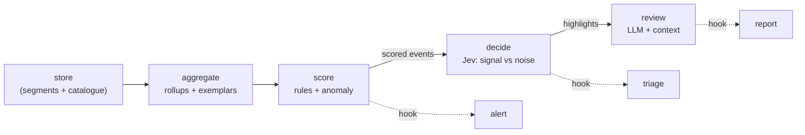

# The guest monitor's host side: storage, filtering, the analysis pipeline and hooks

Status: **design**, 2026-10-04. Builds on [ADR-0032](./adrs/0032-a-root-collector-in-the-guest.md)
(slices 1–2: Tetragon in the VM, the signed spool, the host pull and join). What is built today:
the compressed, budgeted store and its catalogue (§2.1), and the hook mechanism and its file sink
(§6). Everything else here is proposed, with the measurements it rests on.

## 1. What the events look like

From the slice-2 live runs on a Lima `template:podman` guest (Fedora 44, Tetragon v1.7.1,
`fy-observe` policy, `enable-process-ns`), a VM with a box and a stack, under QEMU TCG:

- **~7 events/s at rest**, ~2.1 KB each as stored (the full Tetragon event: the process, its
  parent, eleven namespaces). About **53 MB/hour** raw at that rate (7 × 2.1 KB × 3,600 s —
  derived from the two measurements, not measured itself).
- **60% of events are process exits.** The single largest source is `pasta` exiting (14%); then
  shell plumbing — `readlink`/`basename`/`ln`/`rm`/`grep`/`grepconf.sh` — from login shells and
  Lima's own boot scripts.
- **The monitor watched itself three times** before it was fixed: the policy covered the spool
  (fixed: inbox only), every pull logged in afresh (fixed: one multiplexed ssh connection), and
  each pull still runs `bash`, `find`, `sort`, `stat`, `tail` in the VM — ~120 events a pull,
  still open (§4).

## 2. Storage: what was measured

The same real records (9,692 from a clean boot; 72,001 from all runs) stored six ways. Sizes are
on disk; "q" is a two-minute time-window count and a group-by on binary × kind:

| store | B/event (clean / all) | ingest | q window / group-by | memory to open | install |
| --- | --- | --- | --- | --- | --- |
| JSONL, as today | 2,108 / 2,116 | — | full scan | — | stdlib |
| JSONL + zstd-3 stream | 52 / 24 | fast | full scan (decompress) | — | `zstandard` |
| JSONL, **zlib per 1,000-row batch** | **69 / 39** | 180–240 MB/s | per batch | — | **stdlib** |
| JSONL, lzma-6 | 39 / 17 | 12–20 MB/s | full scan | — | stdlib |
| SQLite, raw JSON + columns | 3,170 / 3,944 | 0.5 / 5 s | 0.3 ms / 18–142 ms | 11 MB | stdlib |
| SQLite, zstd per row | 939 / 1,044 | 0.2 / 2.9 s | 0.2 ms / 6–55 ms | — | `zstandard` |
| **chDB** 4.4.0, MergeTree, ZSTD(3) columns | **119 / 89** | 2.1 / 3.9 s | 5 ms / 4–8 ms | **403 MB** | **534 MB** + pandas + pyarrow |
| DuckDB 1.5.6 | (not sized) | | | 56 MB | ~25 MB |

**chDB is a strong analytical engine and a poor fit as foldyard's store**, for three reasons that
the measurements and its own docs agree on:

1. **One process per data directory.** A second process opening a store a writer holds is
   refused (`Cannot lock file …/status. Another server instance in same directory is already
   running`) — tested, and documented upstream (one data path per process; a session-level
   lock). The supervisor writes continuously, so `fy monitor`, the TUI and any hook would all
   have to read *through* the supervisor over IPC. DuckDB behaves the same way (a read-only
   open is refused while a writer holds the file).
2. **Footprint.** 403 MB resident just to open a session — in a supervisor that today runs in
   tens of MB — and 534 MB on disk plus pandas and pyarrow, for every foldyard install.
3. **It doesn't compress better than the standard library here.** MergeTree with ZSTD columns
   stored 89–119 B/event; zlib over 1,000-row batches of the same JSON stored 39–69 B/event. The
   records are highly repetitive JSON, and batch compression captures that as well as columns
   do.

What chDB (or DuckDB) *is* good for: querying immutable compressed files without owning them.
Both read gzip'd JSONL directly (`file('…/*.jsonl.gz', JSONEachRow)`), with no lock — so they fit
as an **optional engine for the analysis stages** (§5), not as the store.

**Proposed store — stdlib only:**

- **Segments:** append-only `JSONL` files, one per hour per tier, each batch the pull stores
  written as one gzip *member* (a valid gzip stream grows member by member; `zcat`, Python's
  `gzip`, chDB and DuckDB all read it). Closed segments are immutable. ~40–70 B/event.
- **A SQLite catalogue** beside them (WAL mode: one writer, any number of readers, including
  while the writer writes): which segments exist and what they cover, the rollups (§3), the
  exemplars, and each hook's cursor. Small, indexed, and the thing `fy monitor`/the TUI query.
- The supervisor is the only writer; every reader opens files and the catalogue read-only.

### 2.1 Built: the store today

A first step towards that, stdlib only, in `src/foldyard/monitorstore.py`:

- **Segments.** `logs/monitor.jsonl` is the live one; its first line names it
  (`{"k": "segment", "id": …}`). Past 32 MB it is renamed `monitor.<id>.jsonl` and gzip-compressed
  to `monitor.<id>.jsonl.gz`: 2,443 B a record raw, 81 B compressed on a real 33.7 MB segment
  (30×, 0.1 s). A position is `[segment id, offset]`, the offset in uncompressed bytes, so it
  survives the rename and the compression; an inode would not (and ext4 reuses them).
- **A disk budget**, 8 GB per project by default (≈106 M events at 81 B: 57 hours at the
  520 events/s storms of 2026-10-21, 41 days at a steady 30). It was 1 GB until 2026-10-23: a real
  project's monitor wrote 4.5 MB an hour idle and 21–61 MB an hour in busy experiment batches,
  and its full 1 GB store was observed to reach back only 15–35 hours (17–49 by that arithmetic
  alone), so evidence was rolling off before it was read; 8 GB holds 5–16 days of those batches.
  Several monitored projects each get their own budget. Host-only: `max_mb` in
  `~/.foldyard/<project>/monitor-store.toml`, 64 MB–64 GB. The oldest compressed segments go
  first; the live one never does. Not `foldyard.toml`: the store is the evidence of what ran in
  the box, and the box can write the checkout.
- **A SQLite catalogue** (`logs/monitor-index.sqlite`, WAL; derived data, rebuilt from the
  segments if lost): every snapshot, each container's latest engine claim, each segment's event
  time range and which boot's sequence numbers it holds. A record's entry is written before the
  record itself, and every reader first indexes whatever isn't yet (an older store, a crash).
  When a segment goes, its snapshots go too, except the newest of each boot: the one before the
  oldest events still kept. It also keeps each container init's **marks** (below), for the same
  reason it keeps the snapshots: a mark can sit in an earlier read than the event it decides.
  And each namespace's **facts** (below): the same marks with where each init came from, podman
  entering a namespace from the VM's own, and anything entering one from elsewhere (an `other`),
  each kept once a run. The marks and entries were a few thousand rows over cabash's boot; the
  `other` facts, added after that measurement, add a row each time a run of them starts on a
  namespace (a container's runtime entering it, `podman exec`). When a segment goes, the newest fact of each kind about each namespace stays: podman
  entered its own once, at boot, and the join must still know it.

**Why the catalogue (2026-10-21).** The join needs the snapshot before an event and the one after
it. Readers used to look only within a byte window — a hook 1 MB back and 4 MB on from its
position, `fy monitor` the last 8 MB — and the relay snapshots once a minute. In stack-start
storms (265–520 events/s, 2.2–3.7 KB each) two snapshots were 6–90 MB apart, so the events between
had neither in view: hooks released them after two minutes as `unattributed`, a `who =
["container"]` hook dropped them, and its cursor moved on. A replay of the real store against the
real hook code reproduced the lost events exactly; the same replay through the catalogue delivered
every container event the whole-store join finds. Nothing was lost in transport. Events from
before the fix that the old store rotated out can't be recovered.

**Why the marks (2026-10-23).** The kernel hands a freed mount-namespace number to the next
namespace made, the lowest free one, so a container started right after another died often gets
its number. When no snapshot fell between the death and the new container's first events, the
snapshot before still named the dead container and the one after named the new one, and every
event in between came out `ambiguous`, which a `who = ["container"]` hook drops without a word. On
cabash overnight (2026-10-23 00:00–03:00) that cost five agent containers their opening commands
(6–49 s of them), and the dead containers their last ones: 21,047 events in 00:30–02:10, in 25
handovers. It needs a fast handover, so it comes and goes with the churn: none from 20:00 to
24:00 the evening before, when numbers were reused 5–24 minutes after their holder died, and 16,
7 and 1 handovers an hour from midnight, when a replay's stack replaced the last one within
seconds. The stream itself says where the number changed hands. A container's init is the one
process in the init tree of the container's pid namespace (Tetragon's `in_init_tree`) whose parent
is outside its mount namespace (conmon); `podman exec` comes from outside but never in the init
tree, the init's children are in it but their parent is inside. Its exec is the container
entering the namespace and its exit the container leaving it. So between two disagreeing
snapshots, an event from the last init start on, with no init exit after it, is the next
container's (and only for a process started no earlier than that init: Tetragon's per-CPU buffers
can deliver an event of the old container a moment late), and one up to the first init exit, with
no init start before it, is the old container's. The marks only choose between the two containers
the kernel snapshots named, never a third; a container that came and went inside one window
blocks both; and a mark counts only if its init started after the snapshot before was taken (a
start) or before it (an exit), since the relay reads the export a moment behind and that snapshot
may already have seen the init. They assume Tetragon delivers a container's marks: an exit lost at
random, with a container Tetragon can't mark taking the number next, could mislead them. On cabash
every init exec had its exit. In between, the old container's children dying after its init and
podman's own short-lived namespaces (netavark) stay `ambiguous`. The same window re-joined: 538
`ambiguous` events left, and all five agents' events from their init's first exec on. Three agents
that lived under 40 s were never in any snapshot at all — the relay had already looked for their
number once that minute, and its minute only restarts after 60 s with no snapshot at all — so no
join can name them: their events stay `unattributed`. The relay now snapshots within a second of a
container's init entering a number too (the same mark), makes a number new again when an init leaves
it, and looks for a number no snapshot found again after a minute whatever else it snapshots — which
changes the monitor's boot script, so a monitored VM takes it at `fy machine stop && fy up`.

**Why the facts: who isn't a container (2026-10-23, later).** With the marks in, `unattributed`
was still most of a busy night, and none of it was a container's: in cabash's 00:30–02:10, 403k of
560k came from podman's own rootless mount namespace (conmon, pasta, rpm, crun, netavark,
aardvark-dns) and 106k from image builds. Over the boot: podman 1.02 M, builds 258 k, of 1.49 M.
podman's runs at 7k events an hour on an idle VM and 254k in a busy hour. The docs called it
"usually the box's own throwaway containers". The join now names them from kernel facts the box
can't fake, read off the stored events (so stored history re-joins with it, and nothing in the VM
changed):

- **`podman`** — the namespace a process enters straight from the VM's own: its parent in the
  VM's mount namespace (Tetragon's `is_host`), itself outside the VM's user namespace. That is
  podman entering its rootless namespace, as every podman command does (63k times a boot on
  cabash). Nothing in a container has a parent in the VM's namespace. An entry has no end, though,
  and numbers are reused lowest-free: a namespace is podman's only until something is seen
  entering it from anywhere but the VM's — an init, or a process whose parent was in another
  namespace, neither of them the VM's. Otherwise a box container that takes the number of a
  namespace the VM once entered, and that Tetragon never shows an init for (`--pid=host`), would
  be read as podman's, which a default hook skips (the review of #138). The price: after a step
  into podman's namespace from a container (itself `crossed`), what runs there reads
  `unattributed` until podman next enters it from the VM, seconds on a busy VM.
- **`build`** — an init (`in_init_tree`, its parent outside its mount namespace) started in
  podman's namespace by podman itself rather than conmon: buildah's `RUN` step. 594 of them on
  cabash's boot, none ever named by a snapshot (builds run outside podman's container scopes). A
  container's init comes from conmon there: 921 of them.
- **`vm`** also covers the VM's own user namespace: systemd's sandboxed services
  (systemd-userwork, coredump, udevadm: 1,643 events), each in a mount namespace of its own. A
  rootless container is never in it.
- **An init from anywhere else** — a namespace a process made inside a container (`unshare -Urpm
  --fork`, which any container can do) — says nothing about whose a number is. Read as a
  container's mark, it would let the box end its own container's life early, or pass its work off
  as a build.
- **A container's life** is bounded by its init's marks, paired by the init's pid namespace: none
  of a container's events before its init entered or after it left, except its own processes
  killed after their init (in its pid namespace). That fixes the follow-up #136 left: podman's
  netavark, nft and crun run for an instant in a namespace of their own carrying the number a
  container takes next or just left (the lowest free one), and the snapshot naming the container
  took them in. 6,405 events over the boot, all podman's tools, now no container's. One exception
  is left: a snapshot taken while the runtime set a container up names it for podman's tools just
  before, too (157 events): telling those apart needs the next window's marks, which a hook
  delivering at the first snapshot after an event can't wait for.
- **Crossing** — a process in the VM's or podman's namespace whose parent was in a container's —
  is the kernel's trace of an escape. It is `crossed`, named after where it came from, and never
  left out by a hook's filter. None on cabash's boot. A container's scope holding a process in
  either namespace (a privileged container can `nsenter` there; crun joins a scope a moment
  before it leaves podman's namespace — once on cabash) is `ambiguous`, never filed under them.

What stays `unattributed` (212k over the boot): podman's runtime in a namespace of its own for an
instant (171k: crun re-executing itself, the CA wrapper, netavark), indistinguishable by kernel
facts from a box container started with `--pid=host` that dies before a snapshot; exits of
processes Tetragon never saw start (34k: no namespaces at all); and containers no snapshot named
(8k). Hooks: a hook without `who` now skips `vm` and `podman` (§6), which on that boot is 3.83 M
events delivered → 1.84 M; a `who = ["container"]` hook gets the same 1.37 M less podman's tools,
and every batch now counts what it passed over.

**What a skipped label costs.** A process that escapes a container to the VM user lands in exactly
the namespaces a default hook skips. What narrows it: the step out is `crossed` (sent to every
hook), a container scope holding a process there is `ambiguous`, `passed` counts every skipped
event per batch (a sudden jump in `vm` or `podman` is visible without the events), and
`fy monitor` shows everything. What it can't: what that process does next, once it is a VM or
podman process. Shell commands by the box's uid in the VM's namespace are no signal on their own:
the box runs as the VM user, and the pull's own ssh runs a shell as that user every few seconds.

## 3. Tiers and retention

Budget: **8 GB per project** (configurable), at ~40–70 B/event compressed ≈ 120–215 M events of
full-fidelity history if nothing were thinned. Tiers, each a set of segments:

| tier | keeps | how long |
| --- | --- | --- |
| **everything** | every stored record: events, snapshots, gaps, engine claims | 8 h of activity |
| **most** | everything except the classes in §3.1 | 24 h of activity |
| **aggregates** | rollups per hour × worktree × container name × kind × binary (× destination for connects, × path for files): count, first/last seen, distinct args | until the budget |
| **exemplars** | the raw record of every event the aggregation found off-distribution (§3.2) | forever (own small budget, oldest-first beyond it) |

**Activity, not wall-clock.** Retention counts *hours in which events arrived*, and pruning runs
only at ingest — never on a timer. A finished session followed by silence keeps full fidelity
however long the silence lasts; it ages only as new activity accumulates behind it. (Alternative
considered: wall-clock age, pruned only when new events arrive — simpler, but the first event
after a weekend would prune the whole previous session at once.)

**Budget pressure** prunes in order: `everything` beyond 8 h → `most` beyond 24 h → aggregates,
coarsened (hour → day) from the oldest → exemplars beyond their own cap. Never the current hour.

### 3.1 "Everything" vs "most" — proposal

`most` drops what is high-volume and nearly never the question, and keeps every event that names
a security-relevant action:

- **dropped:** exits with status 0 and no signal (60% of all events; the exec is kept, so "what
  ran" survives — only "it finished normally" is lost), and `vm`- or `podman`-labelled plumbing
  execs whose binary *and* parent are on a short, packaged list (shell init helpers under a login
  shell, podman/conmon/crun internals).
- **always kept:** every exec in a container, a build or `unattributed`; every `crossed` event;
  every connect; every file event; non-zero exits and signals; snapshots, gaps, forgeries,
  engine claims.

Expected: roughly a third of the raw volume. To be checked against real sessions before it's
the default.

### 3.2 Off-distribution exemplars

Kept forever, from what the aggregation sees, per worktree (and, where it holds, per container
name — a claim, so never the only key):

- first time a binary runs; first destination (IP:port, later joined to the proxy's hostname);
  first touch of a watched path; first `unattributed` container;
- a count far above that key's rolling hourly baseline (e.g. > p99 of the last 7 active days);
- every refused file access, every gap, every forged line.

Each exemplar keeps a little context: the records ±N seconds around it from the same container,
so a later review sees what led up to it.

## 4. Filtering at source

Tetragon filters its export before anything is written (`export-denylist`: binary, parent and
ancestor binary, arguments, event type, CEL expressions) and can strip fields from what it keeps
(`field-filters`). Proposed defaults, packaged with the policy (so a change re-provisions the VM,
and an invalid filter stops Tetragon — validated in the host-tier e2e like the policy):

- **The monitor's own transport:** the pull runs one packaged reader
  (`/usr/local/libexec/fy-monitor-spool`, installed by the boot script) instead of a shell
  pipeline, and that reader and its `bash -c` wrapper are denied by argument match. Removes the
  last self-observation loop (~120 events per pull).
- **`pasta` exits** (14% of events; `pasta` is rootless networking plumbing — its *connects* are
  kept, they are the real egress).
- **Fields:** keep `process.ns.mnt`, `.pid` and `.user` and the parent's `ns.mnt` and
  `ns.user` (attribution needs them: §2.1's facts), drop the other namespaces; keep the parent's
  `exec_id` and `binary`, drop the rest of the parent object. Roughly halves an event before
  compression.

Not filtered at source: anything in a container. Source filters are lossy and can't be revisited;
thinning beyond plumbing belongs to the tiers, where `everything` still has it for 8 h.

## 5. The analysis pipeline



1. **Aggregate** (deterministic, in the supervisor): rollups and exemplars as in §3.
2. **Score** (deterministic first): rules — direct egress from a container (a proxy-bypass
   attempt; refused when the VM firewall is on), sensitive-file reads, refused accesses, forged
   lines, gaps — plus simple anomaly scores against each key's baseline. Output: the event, a
   score, and the reasons. Arithmetic and baselines stay in code (plan §8F).
3. **Decide** (a decision model, e.g. Jev's typed Choice/Score outputs): narrow questions over a
   compact bundle — the scored event, its exemplar context, the worktree's recent rollups, and
   trusted task context where it exists — with an explicit *insufficient evidence* answer.
4. **Review** (an LLM): the decision model's highlights with a little more context around each,
   written up for a person.

**Trust:** every string in an event — arguments, paths, binary names — is chosen by whatever ran
in the box. Stages 3 and 4 receive it as quoted data inside a fixed frame, never as instructions;
the evaluation (plan §8F) includes adversarial text in filenames and arguments. Names and
worktrees are claims (ADR-0032) and are labelled as such in every bundle.

None of stages 2–4 is built. Each is reachable today through a hook.

## 6. Hooks (built)

A hook is the operator's program or endpoint, called with batches of attributed events. It is
how a scoring script, a decision model or a notifier plugs in without being part of foldyard.

**Configuration is host-only**: `~/.foldyard/<project>/monitor-hooks.toml`, never
`foldyard.toml`. Repo config is writable by anything in the box: a `command` there would be host
code execution for the box (ADR-0023), and a `url` there would send every event wherever the
box chose. The file is read fresh each round; there is nothing to adopt.

```toml
[[hook]]
name = "score"                      # unique; keys the hook's cursor
command = ["/usr/local/bin/fy-score", "--json"]   # argv, absolute path, no shell
# or: url = "https://hooks.example.org/fy"      # POST, JSON body
# or: file = "/abs/path/events.jsonl"           # the built-in sink: one signed line per batch
# headers = { Authorization = "Bearer …" }      # url hooks only
stage = "events"                    # the only stage today; later: scored, decided, reviewed
kinds = ["exec", "connect", "file"] # optional filters; omitted = all
who = ["container", "build", "unattributed"]   # omitted = all but `skip_unless_asked`
worktrees = ["main"]
timeout = 15                        # seconds
```

- **`who`** is one of `container`, `build`, `unattributed`, `ambiguous`, `podman`, `vm` (§2.1). A
  hook without `who` gets all but `vm` and `podman`; `skip_unless_asked = [...]` at the top of the
  file, before any `[[hook]]`, changes that for every such hook (an invalid value is reported and
  the default kept). An event with `crossed: true` reaches every hook whatever its `who`.
- **Payload** (stdin for a command, the body for a url): `{"schema": "fy.monitor.events/1",
  "project", "hook", "events": [...], "first": [boot, seq], "last": [boot, seq], "gaps": [...],
  "passed": {...}}`
  — the same `Event` fields `fy monitor --json` prints. Besides the attribution (`who`,
  `container`, `name`, `worktree`), each event carries its ancestry: `ppid`, `parent`,
  `parent_args` (the one hop) and `exec_id`/`parent_exec_id` (the links to rebuild the whole tree
  from `exec` events) — how a scorer tells a container's own daemon from what a session ran —
  `mnt`, its mount namespace number (what the join matched; namespace numbers are reused, so
  never a container id on its own), and `crossed`.
- **Passed** (added 2026-10-23, the same schema): how many events this hook's filters passed over
  since its last batch, by `who` — `{"podman": 41230, "vm": 2210}`. Counted at least once (a
  batch retried after a crash may count again), never silently gone: what a batch didn't carry
  and no `gaps` entry covers is in a `passed` count, or owed to the next batch (`fy monitor hook`
  shows it).
- **Gaps** (added 2026-10-21, within the same schema: `gaps` and `mnt` are new keys, nothing
  changed meaning). Every batch carries `gaps`, usually `[]`. Each entry says the batch can't
  vouch for a stretch of the stream:

  ```json
  {"why": "rotated", "after": ["<boot>", 1041], "before": ["<boot>", 9310],
   "since": "2026-10-21T20:44:02.1Z", "until": "2026-10-21T20:51:40.7Z", "detail": "…"}
  ```

  Evidence is missing, or incomplete, for the records strictly between `after` and `before`
  (`[boot, seq]`, in store order; `null` = open), between the event times `since` and `until`
  (`""` = unknown). `why` is one of: `rotated` — the store removed events before this hook read
  them; `transport` — sequence numbers that never reached your computer; `relay` — the relay
  restarted and missed Tetragon's events; `unsettled` — events released after two minutes with
  no snapshot after them in the store (the relay stalled, or the boot ended), attributed from
  the snapshot before alone; `ambiguous` — events the hook's `who` filter passed over because
  the join couldn't place them (the namespace changed hands between two snapshots and the
  containers' inits don't say where; the entry adds `mnt`, the namespace, and is sent only to a
  hook that would have wanted them as `container` events); `skipped` — a batch this hook failed
  to take five times. A gap is
  sent with the batch whose events the cursor moves past it; when nothing the hook wants comes
  with it, a batch carries the gaps alone (`events` empty, `first`/`last` null). Read those
  times as "no evidence", never "nothing happened".
- **Settled events only**: an event is delivered once a snapshot after it exists anywhere in the
  store, so its attribution won't change — or, only when none does, two minutes after it arrived
  (an `unsettled` gap then says so). Never ahead of an earlier event that hasn't settled (a VM
  restarted inside those two minutes would otherwise strand the old boot's tail). Whatever stretch
  a hook reads, it is joined with the catalogue's snapshots around it (§2.1).
- **At-least-once:** a hook's cursor advances only when a batch succeeded (exit 0, or HTTP 2xx).
  A failing batch is retried with backoff and, after five attempts, skipped and recorded. Each
  hook reads the store from its own position (the segment and the offset where its last event
  ends), so a hook that fell behind catches up — up to twenty batches a round — rather than
  skipping to the tail; only the budget removing that position loses events, and the supervisor
  log and the next batch's `rotated` gap say so. A NEW hook starts at the store's last 4 MiB
  (about the last 2,000 events), anchored there the first time it is seen, not its beginning:
  history stays in `fy monitor --since`, and a hook added to a full store isn't handed every past
  event at once.
- **Isolation:** commands run with a minimal environment (`PATH`, `HOME`, `LANG`, `FY_PROJECT`,
  `FY_HOOK`) — never the supervisor's, which holds every `host.env` secret — on their own thread,
  so a slow hook never delays the pull.
- **Managed from the CLI:** `fy monitor hook add NAME` — with `--to-box`, `--file PATH`,
  `--url URL` or `-- /abs/program args…`, and optional `--who`, `--kinds` and `--worktree` filters — appends a
  `[[hook]]` block, after parsing the result the way the supervisor will (a hook it would skip is refused, and so is a filter value no event
  has); `fy monitor hook remove NAME` cuts one block out, and refuses — leaving the file alone —
  when the edit wouldn't parse to exactly the old document minus that hook (an inline array of
  hooks, say). Comments and hand edits survive both. Bare `fy monitor hook` lists each hook with
  its filters and delivery state; `fy doctor` has a row per hook (failing, or batches skipped →
  warn) and one saying when there are none. All of them run on the host only.

### 6.1 The file sink

**Put it in the to-box:** `fy monitor hook add NAME --to-box` writes
`~/.foldyard/<project>/to-box/monitor/NAME.jsonl`, which every box reads at
`/run/foldyard/to-box/monitor/NAME.jsonl` and nothing in the VM can write — the share is
read-only outside the guest ([ADR-0033](./adrs/0033-a-to-box-and-a-from-box-beside-the-checkout.md);
lima on `vz` or `qemu`). The box can read the evidence and can't edit, cut or replace it, and the
lines stay signed, so a copy that leaves your computer can still be checked
(`fy monitor check PATH`). `--to-box` makes the `monitor/` directory once. Where there is no
to-box — the podman backend, or a hypervisor that can't enforce read-only outside the guest — it
says so and points at `--file`, which works as below; a `--file` in a tree the box can write (the
checkout, the worktrees root, the from-box) gets a warning when it is added. A VM or box created
before the to-box needs `fy machine stop && fy up` and then `fy box down && fy box up`.

The rest of this section is the sink itself, wherever it writes. The use that motivated it: an
experiment in the box scores the monitor's events, so the box needs them in a file it can read —
before the to-box, a file in the checkout. The obvious hook, a command running
`sh -c 'cat >> "$1"'` on that path, has two flaws. A shell append follows symlinks, so the box
(which writes the checkout, and whose writes reach the host as the operator) plants `logs → ~` or
`logs/events.jsonl → ~/.zshrc` and aims host writes at any file the operator owns, with content
partly shaped by the arguments of what it ran. And the box can edit or cut the file it is scored
on. `file = "<absolute path>"` replaces that recipe:

- **No symlink is followed that the box could have made.** The sink walks the path from `/`, one
  `openat(…, O_DIRECTORY|O_NOFOLLOW)` per component relative to the one before, then opens the file
  `O_APPEND|O_CREAT|O_NOFOLLOW` and refuses anything but a regular file with one link (a FIFO is
  refused without blocking on it; a hard link would be another file's inode). Resolving the path
  once (`realpath`) and opening it later would be a race the box wins, and resolving through a link
  it planted before the hook existed would point the sink wherever it chose. A link on the way is
  followed only when **root owns it and the operator can't write the directory holding it**:
  nothing running as the operator could have placed or swapped it. That admits the system's own
  (`/tmp`, `/var` and `/etc` on macOS; `/var/run` on Linux) and nothing a box can plant through a
  mount. Any other link is refused with the resolved path to configure instead — the operator
  resolves it, once, knowingly.
- **Directories are never created.** A missing one is usually a mistyped path, and evidence
  written where nobody looks is worse than a refusal that the log, `fy monitor hook` and `fy
  doctor` show. The file itself is created (0644).
- **One write per line**, repeated only for a short write. A write that fails part-way (a full
  disk) is undone: the file is cut back to where it ended, so the sink never leaves a torn line.
  A refused or failed write is a failed delivery: retried with backoff, skipped after five
  attempts, like any other hook.

**Each line is signed and chained.** The key is the sink's own (`<state dir>/monitor-sink.key`,
32 random bytes, 0600, made on first use) — not `monitor-relay.key`, which the guest relay holds.
A line is the batch body (`schema`, `project`, `hook`, `events`, `first`, `last`) plus

```json
{"sink": {"seq": 7, "prev": "<line 6's mac>", "mac": "<hex>"}, "schema": "fy.monitor.events/1", …}
```

where `seq` counts the hook's lines from 1 (kept in the hook's state, so it survives restarts),
`prev` is the previous line's mac, and `mac` is HMAC-SHA256 over the canonical JSON (sorted keys,
no spaces) of the line without `mac`. `sink` is written first, so a line leads with its
sequence. The chain belongs to the file: a hook pointed at another file starts at seq 1 there,
and one file holds one hook's lines. Only the current file's chain is kept, so pointing a hook
back at a file it wrote before starts that file at seq 1 again, after its old lines, and the
check fails it. Give a hook a fresh file instead.

**`fy monitor check PATH [--hook NAME]`** verifies a file against the key and the hook's state:
every mac, the sequence from 1 with no gap, every `prev`, and that the file ends on the seq and
mac the supervisor recorded last — which catches lines cut from the end, the edit the chain alone
can't see. Each line must also be the exact bytes the sink wrote, not just the same JSON: a key
given twice parses last-wins in Python, and a reader that takes the first would see something
else. Nothing unparseable is excused, since the sink never leaves a fragment; the one fragment it
can't prevent, from your computer losing power mid-write, fails the check like an insertion.
It prints the first problem with its line number and exits non-zero. Host only: the box has no
key, and that is the point. At-least-once delivery leaves one shape that is not tampering, and
passes with a note: **a re-sent seq** — written, but the supervisor stopped before recording it:
the same seq again, chained from the same `prev` (it may carry more events). The next line chains
from the re-sent one, and so does the recorded state.

The box can still read the file (the point), and it can still damage it — truncate it, delete it,
fill the disk. The check makes that visible; it doesn't prevent it. A read-only mount the box
gets the events through is the structural fix, scoped separately.

## 7. Open questions

1. **Retention clock:** active-hours (proposed) or wall-clock-pruned-on-ingest?
2. **"Most":** is dropping clean exits plus packaged plumbing the right default, or should `most`
   also drop `vm` execs generally?
3. **Exemplar thresholds:** the p99-of-7-active-days baseline is a placeholder; real sessions
   should set it.
4. **Where scoring runs:** in the supervisor (cheap, always on) or as a hook (replaceable)?
   Proposed: the deterministic rules in the supervisor, models behind hooks.
5. **Snapshot by volume too?** The relay snapshots every 60 s (and ~1 s after a namespace it
   hasn't seen). The catalogue makes the distance between snapshots harmless to the join, and the
   init marks (§2.1) tell a reused namespace number's two owners apart, but a container that
   lives and dies between two snapshots is never named. A snapshot every ~2,000 events or 2 MB of
   spool would narrow that; it changes the relay, so the monitor boot script's id, so every VM
   needs `fy machine stop && fy up`.
