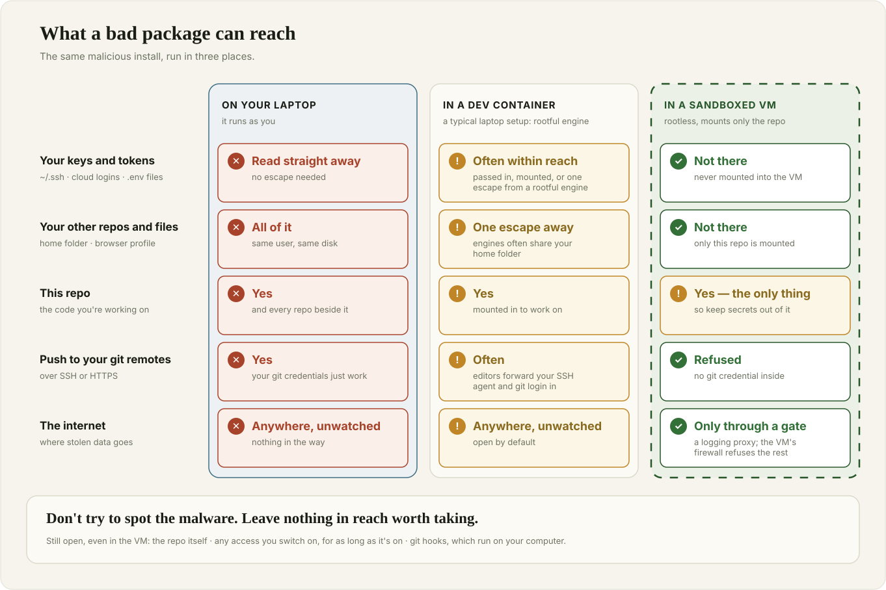
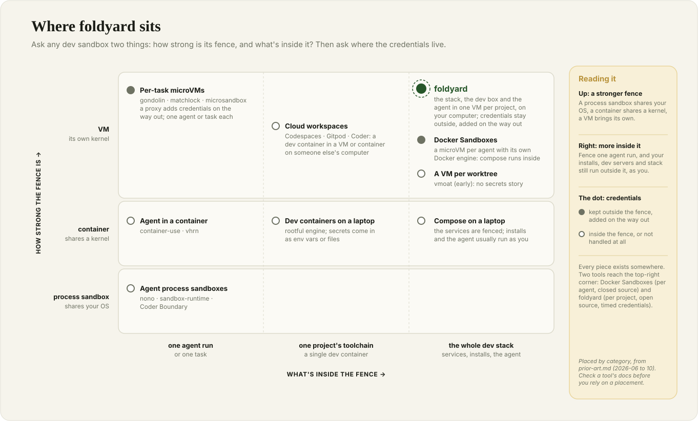
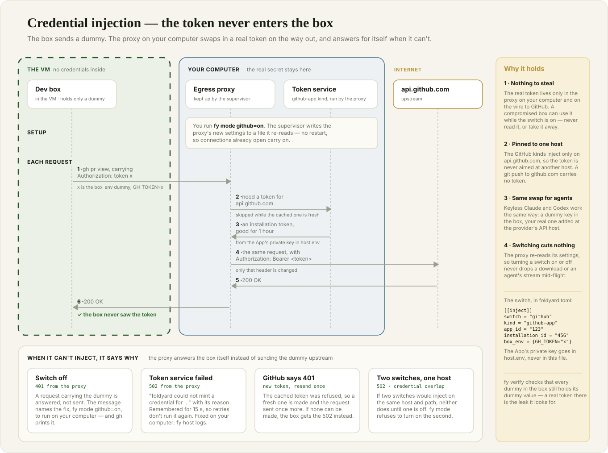
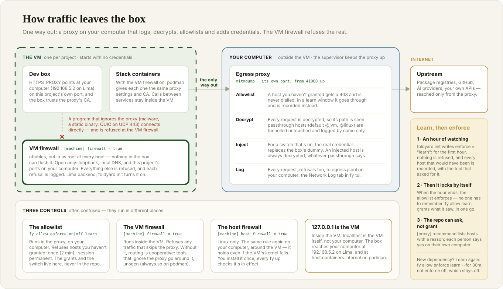
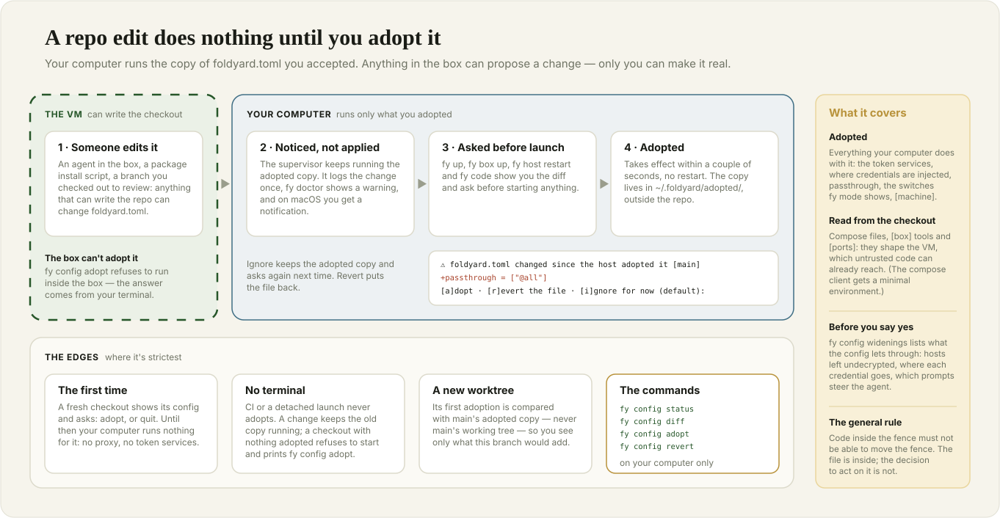
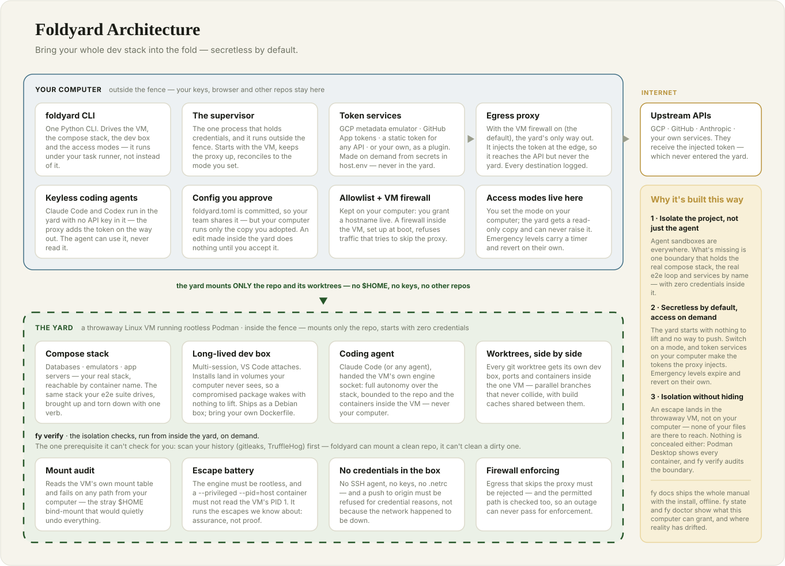
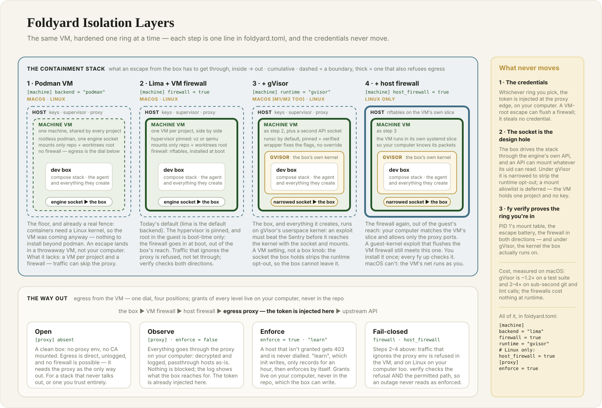
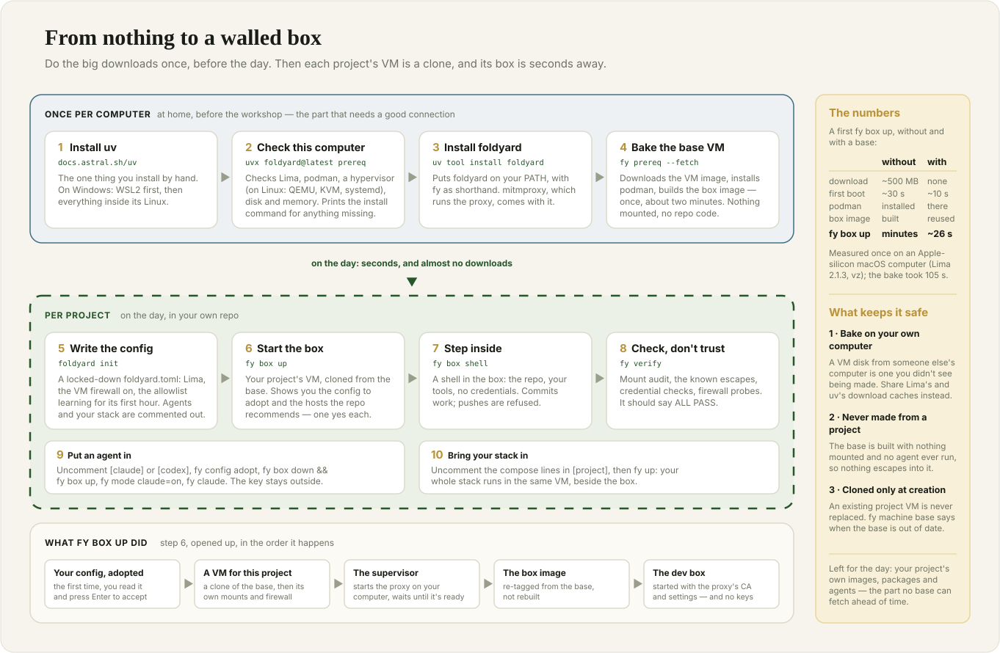

<!-- _class: lead -->
<!-- _paginate: false -->

<span class="kicker">Workshop · part one</span>

# Fencing the yard

## Why your dev environment needs a sandbox — and how to pick one

<!--
Speaker notes. Roughly 35 minutes, then the hands-on part.
The point of this half is NOT "use foldyard". It is: understand the threats well enough to choose
whatever fits your own threat model. Foldyard only appears in part 3, as one worked example.
-->

---

## What you'll leave with

- **Why** a developer laptop is now one of the most valuable targets in a company.
- **Four questions** to ask any sandbox — about files, credentials, network and control.
- **A checklist** for comparing tools, so you can choose one that fits *your* risks.
- Then, hands-on: one of those tools running your own project.

> You don't have to pick the tool we use today. You should leave able to tell a real fence from a painted one.

---

<!-- _class: section -->

### Part 1

# Your laptop is the prize

---

## What's on your laptop right now

<div class="cols">
<div>

- SSH keys — push access to every repo you can reach
- Cloud logins: `gcloud`, `aws`, `az` — often with admin rights
- GitHub / GitLab tokens, `~/.npmrc`, `~/.pypirc`
- `.env` files with real API keys
- Browser sessions, password-manager sessions

</div>
<div>

- **Every other project** you've ever cloned
- Your AI tools' logins and settings
- Your editor and its extensions
- Your shell history

</div>
</div>

All of it readable by **any program you run** — because it runs as *you*.

---

## Who actually runs code on your laptop?

- **You.** Hopefully carefully.
- **Every dependency you install.** `npm install`, `pip install`, `uv sync` run install scripts — code from strangers, with your rights, before you've read a line of it.
- **Your build tools and dev servers**, and everything *they* pull in.
- **Your editor's extensions**, updated automatically.
- **AI agents**, which read untrusted text (issues, web pages, docs, other people's code) and then run commands.

> The shared entry point: **code you didn't write, running with your rights.**

---

## Story 1 · A worm in the package registry

**Shai-Hulud** — npm, September 2025, and again since.

1. You install a package that a compromised maintainer account republished.
2. Its install script searches your laptop for secrets (it literally runs a secret scanner).
3. It uses your npm token to publish infected versions of **your** packages.
4. It dumps what it found into a new public GitHub repo.

The worm spreads itself. Its fourth generation (2026) also targets CI pipelines and plants persistence in developer tools.

<!--
Sources: Krebs on Security, ReversingLabs (first wave from 14–15 Sep 2025; Krebs: at least 187 packages in days);
Tenable's Mini Shai-Hulud FAQ (2026). Counts differ between sources — quote "hundreds of packages".
-->

---

## Story 2 · Malware that asked your AI for help

**Nx "s1ngularity"** — August 2025.

- Malicious versions of a popular build tool shipped an install script.
- It looked for AI command-line tools on the laptop — Claude, Gemini, Q — and ran them, safety prompts off, to **search the disk** for it.
- Results went to a public repo in the victim's own GitHub account.
- In a second wave, stolen tokens were used to make thousands of private repos public.

Your AI tools are capable, logged in and *on your laptop*. That makes them part of the attack surface.

<!-- Source: Wiz, StepSecurity write-ups (Aug 2025). Wiz: 400+ users/orgs, 5,500+ private repos exposed. The malware's own collector went for wallets, keystores, .env files and SSH keys; Wiz describes the AI CLIs as used for "reconnaissance" with flags like --dangerously-skip-permissions and --yolo. -->

---

## Story 3 · Instructions hidden for your agent

**TrapDoor** — May 2026, npm + PyPI + crates.io.

- The usual: packages that steal SSH keys, cloud credentials and tokens.
- The new part: pull requests to popular AI projects that try to add **`CLAUDE.md`** and **`.cursorrules`** files with hidden instructions.
- The instructions asked the coding assistant to run a "security scan" — that finds and sends out secrets.

A file your agent reads *is* code your agent runs.

<!-- Source: Socket research, reported by The Hacker News, 25 May 2026. -->

---

## Story 4 · The editor update

**A trojanised VS Code extension** — May 2026.

- A backdoored release of a popular extension was live on the marketplace for **minutes**.
- Auto-update delivered it to existing users as a routine update.
- One of the affected laptops belonged to an employee at GitHub; GitHub confirmed internal repositories were taken.

Nobody clicked anything suspicious. The update *was* the attack.

<!-- Sources: BleepingComputer, Cloud Security Alliance research note (May 2026). Window reported as 11–18 minutes. -->

---

## Story 5 · It comes back after you clean up

The 2026 worm generation installs **persistence** on developer machines:

- a background daemon that watches your GitHub token — and deletes files if you revoke it;
- injected **editor tasks** (`.vscode/tasks.json`);
- injected **AI-agent hooks** in `~/.claude/settings.json`.

The published advice: find and remove all of it *before* rotating your credentials.

> Rotating keys after an infection is necessary. It isn't a clean-up.

<!-- Source: Tenable, Mini Shai-Hulud FAQ (2026). -->

---

<!-- _class: diagram -->

## The pattern: everything is one hop away



<!--
Left: on a normal laptop, one malicious install script reaches every key, every repo, the browser,
and can send anything anywhere. Right: in a sandbox, it reaches the one repo, holds no keys, and
its traffic goes through a gate.
-->

---

## The lethal trifecta

Simon Willison's name for the combination that turns an AI agent into a data leak:

<div class="cols">
<div class="card">

### 1 · Private data
Your keys, your code, your customers' data.

</div>
<div class="card">

### 2 · Untrusted content
Issues, web pages, docs, dependencies — anything someone else wrote.

</div>
</div>

<div class="card">

### 3 · A way to send data out
Network access — or anything that can *become* network access (a push, a comment, a URL).

</div>

A developer laptop running an agent has **all three by default**. Take away **any one** and the attack falls apart. A sandbox is a way of taking away legs.

<!-- Source: simonwillison.net, "The lethal trifecta for AI agents", 16 June 2025. -->

---

<!-- _class: section -->

### Part 2

# What a sandbox must get right

---

## Four questions — then one more

| | Ask | What "good" looks like |
| --- | --- | --- |
| **Files** | What can code inside *see*? | Only the project. Not your home folder, not your other repos. |
| **Credentials** | What can it *hold*? | Nothing by default. Access you switch on, for a while, narrowly. |
| **Network** | What can it *send*, and where? | Everything goes through a gate you control, and the gate can't be skipped. |
| **Control** | Can the inside *move the fence*? | No. Config the inside can edit doesn't take effect until you approve it. |

**And:** can you **check** it? A fence you can't test is a fence you're taking on trust.

---

## How strong is the fence?

| Fence | Separates | Typical gap |
| --- | --- | --- |
| **Permission prompts** in the agent | intentions | You click "yes" 200 times a day. Install scripts never ask. |
| **Process sandbox** (macOS Seatbelt, Linux Landlock / bubblewrap) | one process | Usually one agent, not your whole stack; rules are easy to get subtly wrong. |
| **Container** | processes, files | Shares your kernel. Whoever has the container engine's socket is effectively root. |
| **Virtual machine** | a whole OS | Its own kernel. Costs memory and some speed. |
| **Remote machine** (Codespaces and friends) | everything | Your code and data live on someone else's computer; you need a network. |

Stronger fences cost more. The question is what you need to keep *in*, and what you need to keep *out*.

---

<!-- _class: diagram -->

## The landscape



<!--
Read it as two questions. Up: how strong is the fence. Right: how much of your work fits inside
it — one agent run, or the whole dev stack (database, services, tests, editor backend).
Most agent sandboxes are strong but small. Most dev environments are big but not a security fence.
-->

---

## Files: mount the project, nothing else

- A **container engine on macOS or Windows** runs inside a VM — and that VM often shares your **whole home folder** into it. One container escape and every key is readable again.
- "Mounts only the repo" also means the repo's **ignored files**: `.env`, `*.pem`, `credentials.json`.
- So: **scan the working tree, not just history** — then move real secrets out of the folder.

```bash
gitleaks git .       # the history
gitleaks dir .       # every file in the folder, ignored ones too
```

> A sandbox can mount a clean repo. It can't clean a dirty one.

---

## Credentials: the best secret in a sandbox is none

- **Nothing at rest.** No key files, no token variables, no credential helpers inside.
- **Swap at the edge.** The inside holds a dummy; a proxy *outside* swaps in the real credential as the request leaves. The API sees the real token; the sandbox never does.
- **Short-lived and narrow.** Prefer tokens that expire in an hour and can do one job.
- **"Act as me" is an emergency.** Anything with *your* identity gets a timer and switches itself off.

This used to be rare. In 2026 it became close to standard in agent sandboxes — good news when you're choosing.

---

<!-- _class: diagram -->

## Swapping the credential at the edge



---

## Network: the third leg

- Exfiltration needs a way out. **Controlling egress is how you take away that leg.**
- **Proxy settings are a suggestion.** Well-behaved tools honour `HTTPS_PROXY`; malware, Go binaries and many SDKs ignore it.
- **A firewall makes it a rule.** Traffic that skips the proxy is refused, not just logged.
- **An allowlist** decides where traffic may go. Learn for a while, review what you saw, then enforce.
- Watch for **"trusted" hosts** that are also places anyone can upload to (package registries, GitHub, pastebins).

---

<!-- _class: diagram -->

## Gating the way out



---

## Control: the inside must not move the fence

**Story:** an agent inside a sandbox edited the project's sandbox config. The change reached the outside within two seconds — including *where credentials were sent*.

- Anything the inside can **write**, the outside must not **trust**: repo config, compose files, scripts.
- The reverse is just as important — repo files that **run on your computer**:
  - dev container `initializeCommand`
  - editor tasks and recommended extensions
  - git hooks and aliases, `.envrc`
- Fix: the outside runs a copy **you approved**, after reading the diff.

<!-- Story: docs/archive/lessons.md §5 (the channel, not the field) and ADR-0022. -->

---

<!-- _class: diagram -->

## A repo edit does nothing until you adopt it



---

## Verify, don't trust

- A sandbox should **test itself from the inside**: what's mounted, which escapes fail, which credentials are absent, whether traffic that skips the gate is refused.
- **Test the test.** One self-check printed *ALL PASS* when its probes had never run; the fix was a control that must succeed first, proving each probe ran.
- Re-run it after every config change.

> If the only evidence that the fence holds is the vendor's README, you don't know.

<!-- Story: docs/archive/verify-false-pass.md -->

---

## What no sandbox fixes

- **It can still change your code.** Review diffs; let CI and branch protection do their job.
- **Access you switch on can be used while it's on.** Don't switch on a credential and then run an untrusted install.
- **A dirty repo stays dirty.** Secrets in the project folder are inside the fence.
- **Full autonomy inside is still full autonomy.** An agent can wreck its own sandbox — that's the point of making it throwaway.
- **Humans approve things.** A diff nobody reads is a gate nobody guards.

---

## Questions to ask any sandbox

1. Does it have **its own kernel** (a VM), or share yours?
2. What exactly is **mounted** — and is your home folder anywhere near it?
3. Where do **credentials** live? Can the inside ever read one?
4. Is egress **enforced**, or only routed when software cooperates?
5. Can the inside **edit the config** that the outside obeys?
6. Does it ever **run repo files on your computer**?
7. Does it hold your **whole dev loop** (database, services, tests, editor), or just one agent run?
8. Can you **verify** it yourself?

---

<!-- _class: section -->

### Part 3

# One answer: foldyard

---

<!-- _class: diagram -->

## The one-glance picture



---

## How foldyard answers the questions

| Question | Foldyard's answer |
| --- | --- |
| Own kernel? | Yes — a throwaway Linux VM per project (Lima), rootless Podman inside |
| What's mounted? | The repo and its worktrees. No home folder |
| Credentials? | None by default. Switched on per job, mostly swapped in by the proxy; "act as me" levels expire |
| Egress? | Every request goes through a proxy on your computer; a VM firewall refuses anything else |
| Inside edits config? | Inert until you read the diff and adopt it |
| Repo code on your computer? | foldyard runs none: its config is data. Your git still runs hooks |
| Whole dev loop? | Yes — your compose stack, the dev box, your editor's backend, the agent |
| Verify? | `fy verify`: mounts, escape attempts, credentials, traffic that skips the proxy refused |

---

<!-- _class: diagram -->

## Harden it one step at a time



---

## If foldyard isn't for you

Good — pick by your threat model, not by ours.

- **Just one agent, short tasks?** A per-task agent sandbox (VM- or process-based) may be all you need.
- **Already on dev containers?** Harden them: rootless engine, no home-folder mount, no secrets in env, an egress gate.
- **Can't run a VM locally?** A remote dev environment moves the whole risk off your laptop.
- **Whatever you pick:** run it through the eight questions.

Foldyard's own survey of the landscape: `docs/prior-art.md` in the foldyard repo.

---

<!-- _class: section -->

### Part 4

# Hands on

---

<!-- _class: diagram -->

## From nothing to a walled box



---

## Today's plan

| | Do | Look for |
| --- | --- | --- |
| 0 | `fy prereq` | no ✗, base VM ✓ |
| 1 | `cd your-repo` → `foldyard init` | a `foldyard.toml` to read |
| 2 | `fy box up` → `fy box shell` | "cloning the base VM" — seconds, not minutes |
| 3 | `fy verify` (on your computer, then in the box) | ALL PASS |
| 4 | uncomment `[claude]` or `[codex]` → `fy config diff` → `fy config adopt` → `fy box down && fy box up` → `fy mode claude=on` → `fy claude` | a hidden prompt for your key, once |
| 5 | ask the agent to fill in your stack → `fy config diff` → `fy config adopt` → `fy up` → `fy open` | your app, running in the VM |

The allowlist **learns for its first hour**. When it starts refusing, `fy allow learn` grants what it saw, after you've reviewed it.

---

## When something's off

- `fy doctor` diagnoses; `fy tui` shows the same checks, with one-click fixes.
- **Changed the config and nothing happened?** It needs adopting: `fy config diff`, then `fy config adopt`.
- **Agent gets 401s?** The switch is off: `fy mode claude=on`.
- **A request refused?** Find it in `fy tui`'s Network Log and grant it there, or `fy allow add <host>`.
- **Everything's slow or swapping?** Lower `memory_mib` under `[machine]`, `fy config adopt`, then `fy machine recreate`.
- **Reading more:** `fy docs` — the whole manual, offline, matched to your version.

---

## Sources and further reading

- Simon Willison, [The lethal trifecta for AI agents](https://simonwillison.net/2025/Jun/16/the-lethal-trifecta/) (June 2025)
- Shai-Hulud: [Krebs on Security](https://krebsonsecurity.com/2025/09/self-replicating-worm-hits-180-software-packages/) (Sep 2025); [Tenable — Mini Shai-Hulud FAQ](https://www.tenable.com/blog/mini-shai-hulud-frequently-asked-questions) (2026)
- Nx "s1ngularity": [Wiz](https://www.wiz.io/blog/s1ngularity-supply-chain-attack) (Aug 2025)
- TrapDoor: [The Hacker News](https://thehackernews.com/2026/05/trapdoor-supply-chain-attack-spreads.html) (May 2026)
- VS Code extension breach: [BleepingComputer](https://bleepingcomputer.com/news/security/github-confirms-breach-of-3-800-repos-via-malicious-vscode-extension); [CSA research note](https://labs.cloudsecurityalliance.org/research/csa-research-note-vscode-extension-supply-chain-breach-20260/) (May 2026)
- Foldyard: [github.com/twistco/foldyard](https://github.com/twistco/foldyard) — `docs/archive/lessons.md` has more stories from building it

<!-- Figures in the incident write-ups differ between sources and change as investigations go on. Re-check them the week of the talk. -->

---

<!-- _class: lead -->
<!-- _paginate: false -->

# Questions?

Then: laptops open.

`uvx foldyard@latest prereq`
